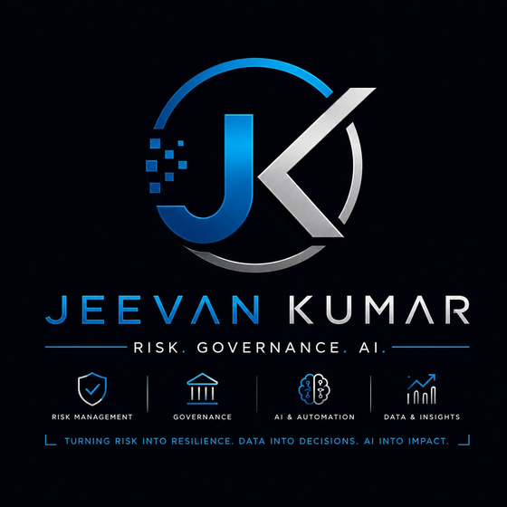

# DORA Compliance Scanner

A self-assessment coverage tool for the EU Digital Operational Resilience Act, Regulation (EU) 2022/2554.
You work through 19 requirements drawn from the regulation's operative chapters, mark the evidence you
actually hold for each, and see your coverage — chapter by chapter and overall.

**Live tool: https://jeevan-0508.github.io/dora-compliance-scanner/**

It runs entirely in the browser. Nothing you type is transmitted, logged or sent anywhere — your answers
are saved only to this browser's local storage, so you can close the tab and pick up where you left off.

## What it is not

**Not a compliance certification and not legal advice.** The tool reports *requirement coverage*: the
share of the model's requirements you can currently evidence as Present or Partial. Full coverage means
your evidence is consistent with the requirement as plainly described here — it does not mean a
supervisor, auditor or court has confirmed compliance.

**Not a claim of financial-services DORA experience.** DORA applies to banks, insurers, investment firms,
payment institutions and their ICT third-party providers — a sector I have not worked in. My background is
carrier and vendor fraud risk in Amazon logistics, not financial services regulation. This tool is a
structured, honest reading of a named EU regulation, built the same week as several other risk-assessment
tools in this portfolio (see Companion projects below) — a demonstration of building a requirements model
and a scoring engine over it, not a claim of domain expertise in DORA compliance.

## The model

The 19 requirements come from **Chapters II–VI** of the regulation — the chapters a financial entity
applies to itself:

| Chapter | Subject | Requirements |
| --- | --- | --- |
| II | ICT risk management (Art. 5–16) | 9 |
| III | ICT-related incident management, classification and reporting (Art. 17–23) | 3 |
| IV | Digital operational resilience testing (Art. 24–27) | 3 |
| V | Managing of ICT third-party risk, Section I (Art. 28–30) | 3 |
| VI | Information-sharing arrangements (Art. 45) | 1 |

Two parts of the regulation are deliberately **excluded**: Chapter V Section II (the oversight framework
for critical ICT third-party providers) is a duty of the European Supervisory Authorities, not of a
financial entity, so there is nothing for a self-assessment to check. Chapters I and VII–IX (definitions,
competent authorities, delegated acts, transitional and final provisions) are institutional or
administrative rather than self-assessable controls.

Each requirement is a **plain-language reading** of one article's official title and general scope,
verified against the regulation's article structure — it is a summary for orientation, not a verbatim
quotation of operative legal text. Read the
[regulation itself](https://eur-lex.europa.eu/legal-content/EN/TXT/?uri=CELEX:32022R2554) before relying
on any finding here.

## How coverage is scored

Each requirement carries equal weight — every one is a legal obligation, and assigning relative
"importance" between them would itself be an invented judgement this tool avoids making. A status of
**Present** scores 1, **Partial** scores 0.5, **Absent** and **Unknown** both score 0. Coverage is the
scored weight divided by the total requirement count, per chapter and overall. **Unknown** is tracked
separately from **Absent** in the gap list — an unchecked requirement is not the same finding as a
confirmed missing control, and the tool never quietly collapses the two.

## Verification

`scripts/validate_model.py` refuses to publish a requirement model with a missing field, a duplicate or
malformed article citation, or a mismatch between `data/requirements.json` and its deployed copy in
`docs/`. `tests/engine.test.mjs` recomputes the coverage arithmetic independently of the page — an
all-present model must score 100%, a mixed model must score exactly what the weights say, and every
requirement must land in exactly one chapter. Both run in CI on every push.

| Check | What it covers |
| --- | --- |
| `scripts/validate_model.py` | Schema, unique ids/articles, docs/data parity |
| `tests/engine.test.mjs` | Coverage and completeness arithmetic, banding thresholds, chapter partitioning |

## Licence

Code: **MIT**. The requirement model in `data/`: **CC BY 4.0** — reuse it in your own programme, with
attribution.

Provided for self-assessment purposes. It is not legal advice, it does not determine DORA compliance, and
it contains no confidential or employer-specific material.

Built by [Jeevan Siddhabhaktula](https://github.com/Jeevan-0508). Companion projects:
[AI Risk Control Room](https://jeevan-0508.github.io/ai-governance-control-room/docs/),
[Freight Risk Atlas](https://jeevan-0508.github.io/freight-risk-atlas/),
[EU AI Act Scanner](https://jeevan-0508.github.io/eu-ai-act-scanner/).
